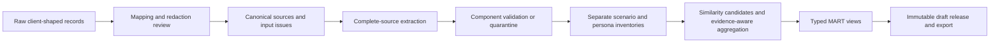

# Snowflake evidence engine

This is the operator guide for the deployable evidence engine. It turns complete, permitted source records into versioned scenario and communication-persona drafts, then creates an immutable export document. The supported route is the repository's Python CLI and a Snowflake Python stored procedure. Processing, provider requests, validation, aggregation, marts, and release writes happen in Snowflake; dbt is not required.

The commands in this guide are instructions, not evidence that a Snowflake installation or model run has occurred. All commands are dry-run by default. Only an explicit `--execute` connects to Snowflake.

The engine is an MVP for a bounded synthetic demonstration. Version 0.3.0 adds
`engine-storage-v3` and `engine-export-v3`, explicit delivery scope in the
scenario/persona marts and export, and a safe retained-response replay/import
route. `split_v3` remains experimental and opt-in; the generated configuration
still defaults to the existing extraction path. These capabilities do not
certify client policy correctness, semantic correctness, source-population
coverage, learner outcomes, or production readiness. Client-owned guidance is
never inferred from a historical interaction.

## What the engine does

The engine keeps the full permitted source record, including its provenance, then performs these stages:



The route intentionally ports the old dbt work's mapping, readiness, redaction, content-hash, and incremental principles without carrying its representative-excerpt generation or treating old clustering as semantic equivalence. The former dbt project is preserved under `archive/legacy/dbt/` in the working repository. It is excluded from the portable engine release.

## Before you start

An administrator prepares an existing Snowflake database, warehouse, and role, plus a **new dedicated schema** for the engine. Do not install into an existing MVP or client schema.

The role used to execute the stored procedure must be able to create and use the engine's schema-local objects, stage the package, and use the configured Snowflake AI functions. The procedure runs as its caller, so access is evaluated as the executing role. This repository supplies no live `GRANT`, warehouse-alteration, or user-access command; account administrators must apply their own least-privilege policy.

The local CLI needs Python 3.11 or 3.12. Install it with `python -m pip install -e .`; use `python -m pip install -e ".[dev]"` for offline tests. `deploy/engine/requirements.txt` mirrors the runtime dependencies. The stored procedure is pinned to Python 3.11 and Snowpark 1.26.0. Do not commit credentials: `--env-file` is an explicit local convenience for `SNOWFLAKE_*` values only.

The configured model and embedding model must be available in the selected account and region. Check this with the account administrator before live execution. The engine does not silently substitute or upgrade a model.

## 1. Clone and create a non-secret configuration

Clone the repository, enter it, and inspect the command surface:

```sh
python3 -m snowflake_engine.cli --help
python3 -m snowflake_engine.cli configure --help
```

Create a local configuration with general names. Replace every placeholder with the administrator-provided existing resource name; do not put a password, token, private key, or account locator in this file.

```sh
python3 -m snowflake_engine.cli configure \
  --database YOUR_DATABASE \
  --schema ENGINE_DEMO_ISOLATED \
  --warehouse YOUR_EXISTING_WAREHOUSE \
  --role YOUR_EXISTING_ROLE \
  --client-id fictional-engine-demo \
  --model CONFIGURE_AVAILABLE_CORTEX_MODEL \
  --embedding-model snowflake-arctic-embed-l-v2.0 \
  --output local/engine-config.json
```

`configure` writes a non-secret file. An installer writes `installed-config.json` after it has selected the content-addressed stored-procedure name. Use that installed configuration for `load`, `run`, `inspect`, and `export`.

The generated configuration uses the default **synthetic smoke budget profile**: at most six source envelopes, 60 events, 12 generation calls, 4,096 output tokens per generation request, 128 embedding inputs, 60,000 input characters, one concurrent invocation, a 900-second run cap, and bounded SQL/session timeouts. It is not a permanent product ceiling. A larger profile can be selected only in a separately reviewed configuration before first installation into a new dedicated schema.

Installation persists the exact reviewed profile in engine metadata. Every later native request must stay at or below that installed profile; a run cannot silently widen its budget. Provider attempts are cumulative for the installation, including failures. Unknown limit keys are rejected so a misspelled safeguard cannot be silently ignored. The outer stored-procedure CALL timeout is the run allowance plus one child-statement allowance and a 60-second closeout buffer (1,080 seconds for the smoke profile). Individual child SQL statements remain limited to 120 seconds. This prevents the whole pipeline from being cancelled by the shorter per-statement limit. These controls are safeguards, not evidence that calls have been made.

For the committed fictional demonstration, start from:

- [`configs/engine/example_config.json`](../configs/engine/example_config.json)
- [`configs/engine/synthetic_mapping.json`](../configs/engine/synthetic_mapping.json)
- [`fixtures/engine/synthetic_sources.json`](../fixtures/engine/synthetic_sources.json)

## 2. Review the installation plan, then install only with authority

Generate the package and inspect its plan without connecting to Snowflake:

```sh
python3 -m snowflake_engine.cli install \
  --config local/engine-config.json \
  --output artifacts/engine-install-plan
```

This writes a deterministic package archive, `install.sql`, `schema-manifest.json`, `install-plan.json`, and `installed-config.json`. The plan names the exact archive hash, stage, procedure, schema manifest hash, preconditions, and proposed statements. Review it before a live action.

The install is non-destructive. It creates missing engine objects, uploads a content-addressed archive without overwrite, and creates a new content-addressed procedure. It does not drop prior tables, views, procedures, or packages. If the target contains unversioned or unrelated relations, or the metadata version, manifest hash, or persisted budget differs, it stops before DDL. Use a newly dedicated schema for an upgrade rather than changing an established installation in place.

Only after that review and administrator approval, execute the plan:

```sh
python3 -m snowflake_engine.cli install \
  --config local/engine-config.json \
  --output artifacts/engine-install \
  --execute --env-file local/snowflake.env
```

`local/snowflake.env` is deliberately not a repository file. It may provide the supported `SNOWFLAKE_*` connection settings. The CLI never places credentials in generated plans or logs.

## 3. Map and load evidence

Mapping is configuration, not prompt code. Each raw envelope selects a mapping type using `record_type`; dotted field paths describe where IDs, text, speaker, timestamps, provenance, metadata, and guidance live. Cases, typed chat, call transcripts, and linked notes converge into one canonical source shape. A standalone interaction does not need a fabricated case ID.

The canonical event preserves `event_id`, supplied order, optional timestamp, timing status, kind, role, speaker, authority, permitted text, original text, and redaction status. Missing time remains unknown. A note is always an attributed report; it is not upgraded into direct customer speech. A malformed event excludes its whole source so that extraction never receives a silently incomplete record. The excluded raw record and reason remain in input accounting.

Review the mapping and raw source files locally first. For the fictional seed, the expected result is five mapped source envelopes with 24 events and one visibly excluded orphan note with one event. This is a fixture check, not model-generated evidence.

Create a non-network load plan:

```sh
python3 -m snowflake_engine.cli load \
  --config artifacts/engine-install/installed-config.json \
  --input fixtures/engine/synthetic_sources.json \
  --mapping configs/engine/synthetic_mapping.json \
  --run-id synthetic-engine-load-001 \
  --output artifacts/engine-load-plan.json
```

The displayed plan contains the complete JSON request intended for the stored procedure. Execute only after reviewing source permission, client-owned redaction rules, and the persisted installation budget:

```sh
python3 -m snowflake_engine.cli load \
  --config artifacts/engine-install/installed-config.json \
  --input fixtures/engine/synthetic_sources.json \
  --mapping configs/engine/synthetic_mapping.json \
  --run-id synthetic-engine-load-001 \
  --output artifacts/engine-load.json \
  --execute --env-file local/snowflake.env
```

Loading persists the raw records and reviewed mapping for custody, keyed by stable raw identity and client. It makes no model request. Its load ID records that stage only; use a distinct immutable ID for the processing run.

## 4. Run and inspect the engine

Plan the processing call before executing it:

```sh
python3 -m snowflake_engine.cli run \
  --config artifacts/engine-install/installed-config.json \
  --run-id synthetic-engine-run-001 \
  --output artifacts/engine-run-plan.json
```

The live call invokes the installed procedure. It reads the complete permitted source or fails on the configured input limit; it does not use opening-only truncation. Each provider request is recorded before invocation. Raw responses, failed attempts, returned usage, unknown usage, query IDs, component validation, and source coverage remain available for inspection. Components with invalid shape, attribution, or coverage are quarantined rather than silently repaired.

```sh
python3 -m snowflake_engine.cli run \
  --config artifacts/engine-install/installed-config.json \
  --run-id synthetic-engine-run-001 \
  --output artifacts/engine-run.json \
  --enable-model-calls \
  --execute --env-file local/snowflake.env
```

`run` is cache-only unless `--enable-model-calls` is stated. That extra flag is intentional: it prevents a live cache miss from spending the model allowance merely because a command connected successfully.

Inspect the run, coverage, and output marts with a bounded result limit:

```sh
python3 -m snowflake_engine.cli inspect \
  --config artifacts/engine-install/installed-config.json \
  --view MART_RUNS --limit 100 \
  --output artifacts/engine-inspect-runs.json

python3 -m snowflake_engine.cli inspect \
  --config artifacts/engine-install/installed-config.json \
  --view MART_COVERAGE --limit 100 \
  --output artifacts/engine-inspect-coverage.json
```

Add `--execute --env-file local/snowflake.env` only to inspect installed Snowflake data. The available marts are listed in the [data dictionary](engine/data-dictionary.md), including scenarios, personas, families, variants, compatibility, evidence, guidance, coverage, runs, and releases.

## 5. Export a release

The engine creates an immutable draft release only when it has a non-failed run. First produce the export plan:

```sh
python3 -m snowflake_engine.cli export \
  --config artifacts/engine-install/installed-config.json \
  --release-id RELEASE_ID_FROM_MART_RELEASES \
  --output artifacts/engine-export-plan.json
```

Then retrieve and validate that release if live inspection is authorized:

```sh
python3 -m snowflake_engine.cli export \
  --config artifacts/engine-install/installed-config.json \
  --release-id RELEASE_ID_FROM_MART_RELEASES \
  --output artifacts/engine-export.json \
  --execute --env-file local/snowflake.env
```

`engine-export-v3` is the current documented interchange contract. It preserves
release eligibility, review state, guidance authority, source/model/schema
lineage, accounting, coverage, explicit delivery scope, and limitations. The
reader continues to read `engine-export-v1` and `engine-export-v2`, but those
older forms are read-only; they are not rewritten in place. The export does not
publish to an external training platform. Platform-specific field mapping is
unverified, so no external API field names are claimed.

## Safe reruns, upgrades, failures, and cleanup

### Safe reruns

Every load and processing run ID is immutable. Reusing an existing ID stops instead of overwriting historical evidence. Use distinct stage IDs, for example `synthetic-engine-load-001`, `synthetic-engine-run-001`, and `synthetic-engine-rerun-001`. For a deliberate rerun, use a new processing ID with the same installed configuration and retained raw input/mapping. The native ledger keys cache entries by full source hash, configured model, prompt/schema/code versions, and request content. A matching successful request is reused; a failed or unresolved matching request is not retried automatically. This prevents an unchanged rerun from creating duplicate inference.

For an explicitly diagnosed implementation correction, `reprocess_retained: true` permits reuse of a successful raw response only when its source/request, model, output cap and prompt fingerprint still match. It records the original attempt and the separate processing version. A changed prompt does not qualify for that reuse.

### Retained-response replay and fresh-install import

The default path does not change source order or existing output. An operator can
explicitly select `source_ordinal_v1` only for a cache-only split-v3 replay.
That processing version orders only recognised citation-reference arrays by the
supplied source chronology. Quotes, speaker/role/authority attribution, event
identity, duplicate and uncertainty handling, assertions, all non-citation
arrays, and the source narrative remain exactly as retained. A malformed
reference or unknown event ID leaves the entire citation array unchanged.

The runtime validates original and processed payloads by the same rules. It
keeps the original response, original result and any rejection, then records a
separate processing revision. This is a processing record, not an edit to the
source. Matching cache entries must have the same complete source/request
fingerprint, model, prompt, settings, and output limit. A cache miss fails
closed; it does not start a model request.

To replay preserved responses into a fresh v3 installation, select a frozen
`retained-capture-v1` file explicitly. This mode validates the full source set,
both scenario and persona attempts per source, hashes, original versions,
request keys, and request fingerprints before processing. It records the
artifact and canonical manifest digests. Imported responses are retained as
import evidence; they are not added to or substituted for the original paid
attempt ledger.

```sh
python3 -m snowflake_engine.cli run \
  --config artifacts/engine-install/installed-config.json \
  --run-id retained-replay-001 \
  --retained-captures frozen-retained-captures.json \
  --output artifacts/engine-retained-replay-plan.json
```

The command above creates an offline plan. The flag sets cache-only retained
replay with `source_ordinal_v1`; it does not grant execution authority or enable
model calls.

If a response is cut off at the output-token limit, preserve it as failed capture. An operator may explicitly select source IDs in `compact_source_ids`, for example `["source-17"]`, and authorize a new request within the same remaining allowance. This shared compact route requests minified JSON, concise faithful summaries and minimal sufficient quotes while keeping the entire permitted source, schema and capture requirements. It is not an automatic retry or an opening excerpt. Other sources retain their standard request identities. Keep the same compact selection on the later cache-only rerun. Per-source styles, hashes, cache results and validation status are recorded in run usage.

Changing evidence, model, prompt/schema/code version, or reviewed mapping changes the request identity. It may therefore consume the remaining installation-wide allowance. Review the plan and native ledger first; an exhausted allowance is a stop condition, not a reason to increase the limit or claim success. A code-only deterministic correction can explicitly reuse an exact retained raw response or vector when its source, prompt, model, and output-limit fingerprint matches; that replay is logged and does not create a model attempt.

### Upgrade

The supported upgrade is a fresh dedicated schema. `engine-storage-v3` does not
write into a v1 or v2 schema: the installer treats a different manifest hash or
schema version as a boundary and stops before it changes anything. Preserve the
previous schema, releases, plans, source hashes, raw outputs, and query
evidence. Install the updated package to a new schema, then compare its manifest
and output contract before adoption. Do not hand-edit generated DDL to bypass
the version check.

### Failure handling

A failed input record is retained in `INPUT_ISSUES`; a malformed source is not silently repaired or partially extracted. A failed provider attempt is written before the failure can be reported. Partial or invalid model output is retained and component-level quarantine makes the limitation visible. `MART_COVERAGE`, `MART_RUNS`, `ATTEMPTS`, and the release limitations distinguish processed, cached, failed, excluded, and quarantined sources.

An externally cancelled CALL may prevent final cleanup and leave its writer lease held. Never take over a lease merely because it is old. `scripts/engine/recover.py` builds an explicit recovery plan for an exact failed run and ended CALL, backed by retained query-history evidence. Execution checks the expected run and lease rows, changes only those rows inside a transaction, rolls back on any mismatch and verifies that the provider-attempt ledger hash is unchanged. It neither deletes outputs nor resets the allowance. Inspect the plan before using its explicit `--execute` option.

When a run fails, stop automatic retries. Inspect the plan, run, coverage, issues, attempts, and raw retained provider response. Correct only a diagnosed implementation or configuration problem. Reuse retained output for deterministic correction; do not substitute hand-curated results for engine generation.

### Cleanup

The CLI produces an inventory and instructions but never deletes an installation:

```sh
python3 -m snowflake_engine.cli cleanup-plan \
  --config artifacts/engine-install/installed-config.json \
  --output artifacts/engine-cleanup-plan.json
```

Review the exact dedicated schema and preserve any required release/evidence artefacts. A separately authorized, reviewed administrative cleanup may drop that dedicated schema only after confirming that it contains no unrelated objects. No cleanup command is supplied because deletion needs explicit authority.

## Optional warehouse input

The [warehouse intake guide](engine/warehouse-intake.md) documents `load-table`, which reads an explicit prepared relation inside the stored procedure. The relation must share the configured database/schema and expose `SOURCE_ID` and `RAW_RECORD`. The optional repository dbt example prepares such a view. Install the engine before creating those source objects: the installer currently refuses an existing schema containing co-owned dbt objects, so an in-place upgrade requires further ownership design.

## Evidence and limits

### Stage A result: more delivery, but no semantic promotion

The local Stage A replay completed on the frozen 100-source
`stage-a/replay-candidate` packets, with zero SQL, network, or inference calls.
It retained 94 valid scenarios and 99 valid personas (87 full and 12 explicitly
partial). Both-layer delivery rose from 64 to 93 histories. Support moved from
501 to 520 of 567 issue facts, 190 to 210 of 245 material conditions, and 213
to 213 of 224 observations. Paired gains/losses were 24/5 facts, 22/2
conditions, and 2/2 observations. These measures overlap and show retained
delivery/support, not a combined truth score.

The result does not justify promotion. Histories with a material error in a
valid record rose from 38 to 54. Review found no newly authored claims: the
mechanical replay exposed errors that had previously remained quarantined. That
is a useful diagnostic distinction, but it does not make the increased error
count acceptable. Retain the citation-ordering and partial-delivery safeguards;
do not promote the combined path semantically, change the default, or alter the
rollback selection.

Stage A did not regenerate practice. The prior finding—only 2 of 12 objectives
exercised—remains historical and unresolved. The frozen packet, [validated
summary](../artifacts/demo/best-supported-engine-01/stage-a/scoring/validated-summary.json),
and [aggregate report](../artifacts/demo/best-supported-engine-01/stage-a/scoring/aggregate-report.json)
are the measured local evidence. The [local v3 export receipt](../artifacts/demo/best-supported-engine-01/evidence/stage-a-local-export-receipt.json)
verified all 100 sources and explicit partial scope. No native Stage A deployment
has occurred. The optional processor-v3 known-whitelist correction passed 244
focused tests; that confirms bounded processing behavior, not semantic
readiness.

### Historical development result: `split_v3` remains rejected for promotion

The `split_v3` candidate was exercised on 100 fictional development histories, not client records. Compared with the retained baseline, valid-output support increased from 364 to 501 issue facts, 114 to 190 material conditions, and 113 to 213 customer observations. Those scoring axes overlap and are reported separately. The candidate retained scenarios for 64 histories and personas for 99 histories (86 full and 13 explicitly partial).

The increase in coverage did not make the candidate semantically ready. Histories with a material error in a valid record increased from 25 to 38. The combined capture also missed its promotion thresholds: 64 both-layer histories versus a minimum of 80, and 38 valid-material-error histories versus a maximum of 15. Its practice programme exercised 2 of 12 required objectives. Coordination rejected the combined candidate for promotion. Keep `split_v3` opt-in and experimental; do not describe it as a promoted or client-ready path. Version/partial preservation may be used as traceability and delivery controls, but they are not semantic acceptance.

The evidence is development-only: all 100 histories are fictional, and no client qualification is claimed. The retained baseline, failed findings and the candidate score evidence are described in [current limitations](engine/known-limitations.md).

The engine distinguishes three things that must not be conflated:

- Machine validation checks typed structure, exact citation text, source attribution, supplied order, and vocabulary. It is not semantic acceptance.
- Semantic review determines whether an interpretation is supported and useful. The retained synthetic seed was reviewed and has three unresolved material meaning errors; see [current limitations](engine/known-limitations.md).
- Client guidance authority belongs to the client. Fictional seed guidance is marked fictional; absent guidance is `requires_client_guidance` rather than invented.

Personas are bounded, source-backed observations, not demographic or enduring personality profiles. They keep action labels, contextual sequence evidence, emotional expression, and emotional changes in separate layers. Notes cannot establish direct customer speech. The capture instructions prohibit inferred demographics, native language, diagnosis, inner cause and vocal traits, and prohibit a neutral emotion as an automatic default. Semantic review remains necessary to check that generated wording follows these instructions.

For every stored table, typed mart, nested extraction component, export field, key/grain, null/unknown meaning, and provenance path, see the [engine data dictionary](engine/data-dictionary.md). Offline validation and its outcomes are recorded in [validation evidence](engine/validation.md).


### Resumed pilot closeout — 29 October 2026

Engine 0.3.3 completed the saved twelve-history correction pilot, reusing five successful responses and making seven new calls. Independent review found material errors in seven histories, compared with six before correction; the maximum allowed was two. Ten histories still delivered both a scenario and a persona. The wider batch did not run, and the default remains unchanged. The source-review and practice-planning options remain experimental. The operational fixes preserved stored paid responses, spending records and every generation request. See `artifacts/demo/best-supported-engine-01/r3-pilot-report.md` in the working repository for the measured result and its limitations. This is development evidence; it does not establish client readiness.
